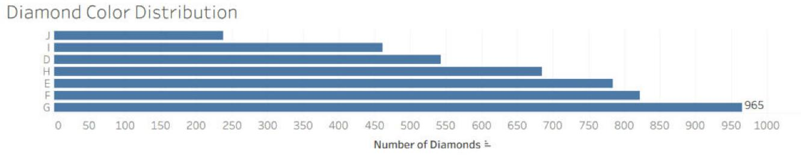
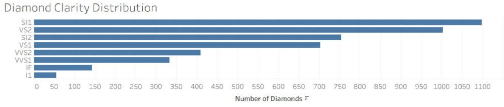
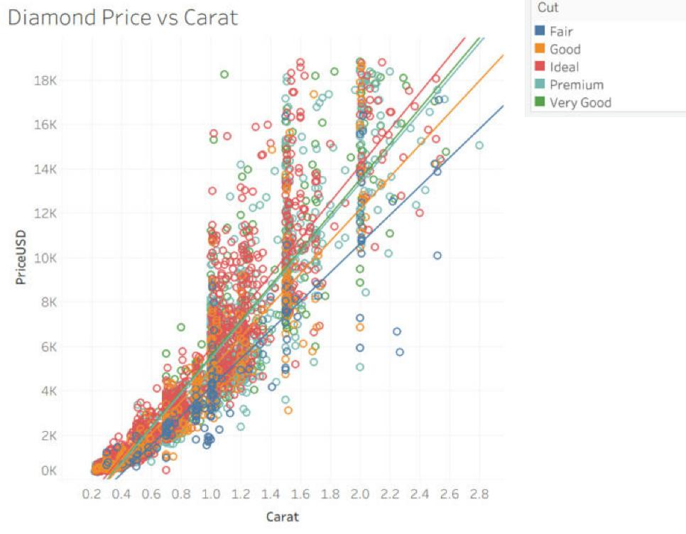
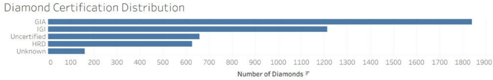
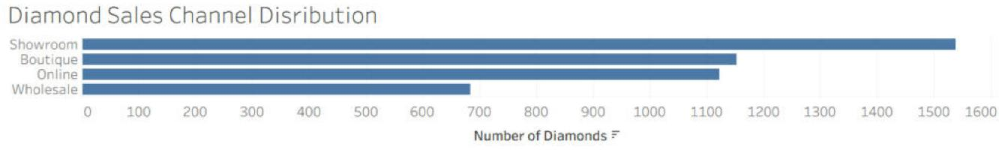

# Diamond Sales Analysis

An end-to-end data analysis project examining the factors that influence diamond selling prices, sales performance, customer behavior, and market segmentation.

The project combines data preprocessing, exploratory data analysis, subgroup comparison, statistical hypothesis testing, machine learning, SQL analysis, and Tableau visualizations to generate practical business insights from diamond sales data.

## Project Overview

The analysis was conducted on a diamond sales dataset covering the period from 2022 to 2024. After cleaning and validation, the final dataset contained **4,498 records and 19 variables** describing diamond characteristics, prices, appraisal values, discounts, sales channels, certifications, customer satisfaction, and sales performance.

The project was designed to answer the following questions:

- Which characteristics have the strongest relationship with diamond selling price?
- How do Cut, Color, Clarity, and Carat affect pricing?
- How closely do selling prices correspond to appraisal values?
- How does performance differ across sales channels?
- Why do Standard diamonds initially appear more expensive than Premium diamonds?
- Is the controlled price difference between Premium and Standard diamonds statistically significant?
- Can diamond prices be predicted accurately using Linear Regression?
- Can diamonds be divided into meaningful market segments using K-Means clustering?

## Technologies Used

- Python
- Jupyter Notebook
- pandas
- NumPy
- Matplotlib
- Seaborn
- SciPy
- scikit-learn
- SQL (SQLite)
- Tableau

## Project Workflow

### 1. Data Preprocessing

The preprocessing stage included:

- Inspecting column types, missing values, unique values, and distributions
- Converting incorrectly formatted numerical fields
- Processing inconsistent date formats (day-first parsing for DD/MM/YYYY values)
- Standardizing categorical values and certification names
- Detecting invalid and unrealistic observations
- Correcting the discount-percentage calculation
- Handling missing numerical and categorical values
- Investigating duplicate records and identifiers (including DIA62001, a duplicate caused by two date formats)
- Removing two confirmed erroneous Carat observations
- Preserving legitimate high-value business outliers
- Performing final validation and exporting the cleaned dataset

The final cleaned dataset contained **4,498 rows**, with no missing values or fully duplicated records.

### 2. Exploratory Data Analysis

The exploratory analysis examined:

- Carat weight and selling price
- The effects of Cut, Color, and Clarity
- Selling price compared with appraisal value
- Discount behavior across sales channels and Carat groups
- Sales-channel performance
- High-price outliers
- Monthly and annual sales trends
- Correlations among numerical and ordinal characteristics

### 3. Subgroup and Deep Analysis

Premium and Standard diamonds were compared across selling price, Carat weight, appraisal value, discount percentage, customer satisfaction, and days on market.

The initial analysis showed that Standard diamonds had a higher overall average selling price. Further investigation demonstrated that this unexpected result was largely explained by their higher average Carat weight.

Comparing the groups within similar Carat ranges produced a more meaningful assessment of the effect of Cut quality.

### 4. Statistical Hypothesis Testing

Welch's independent-samples t-test was used to compare the mean selling prices of Premium and Standard diamonds within the **1–1.5 Carat** range.

| Metric | Result |
|---|---:|
| Premium sample size | 675 |
| Standard sample size | 345 |
| Mean price difference | $310.87 |
| T-statistic | 1.9083 |
| P-value | 0.0568 |
| Cohen's d | 0.126 |

At a significance level of 0.05, the null hypothesis was not rejected. The observed price difference was not statistically significant and had a very small practical effect size.

### 5. Linear Regression

A baseline Linear Regression model was developed to predict selling price using physical measurements and quality characteristics.

Because diamond prices were strongly right-skewed, a second model was trained using a logarithmic transformation of the target variable.

| Metric | Baseline Model | Final Log-Transformed Model |
|---|---:|---:|
| Test R² | 0.9253 | **0.9605** |
| MAE | $743.78 | **$434.22** |
| RMSE | $1,106.92 | **$804.81** |
| MAPE | 41.98% | **10.70%** |
| Median APE | 20.01% | **9.32%** |
| WAPE | 18.92% | **11.05%** |
| Negative predictions | 76 | **0** |

Five-fold cross-validation produced a mean R² of **0.9505** with a standard deviation of **0.0040** for the final model, indicating stable performance across different data partitions.

Permutation importance identified Carat weight as the most influential predictor, followed by physical dimensions and several Clarity categories.

### 6. K-Means Clustering

K-Means clustering was applied after standardizing the numerical features. The Elbow Method supported a three-cluster solution:

- **Entry-Level Diamonds** — smaller diamonds with lower selling prices
- **Mid-Value Diamonds** — moderately sized diamonds with intermediate prices
- **Premium Diamonds** — larger diamonds with substantially higher prices

| Evaluation Metric | Result |
|---|---:|
| Silhouette Score | 0.381 |
| Davies-Bouldin Score | 1.042 |

The results indicate a moderate and interpretable clustering structure. These segments can support inventory planning, product positioning, pricing strategies, and targeted marketing.

### 7. SQL Analysis

The cleaned dataset was loaded into a **SQLite** database with a star schema, and ten business questions were answered with SQL.

| Table | Rows | Description |
|---|---:|---|
| `sales` | 4,498 | Fact table: one row per sale (date, price, discount, days on market, satisfaction) |
| `products` | 4,498 | Diamond characteristics (carat, cut, color, clarity, dimensions, certification, appraisal) |
| `channels` | 4 | Sales channels and channel type (Physical, Digital, Trade) |
| `stores` | 7 | Store locations |

SQL techniques used: `JOIN`, `GROUP BY` with `HAVING`, CTEs (`WITH`), `CASE WHEN`, subqueries, and window functions (`LAG`, `RANK`, `ROW_NUMBER`, `SUM() OVER`, moving averages).

To rebuild the database and run all queries:

```bash
python sql/build_database.py
python sql/run_queries.py
```

The query results are exported to `sql/results/` as CSV files, which can be used directly as Tableau data sources.

#### Q1. How did sales volume and revenue grow year over year?

<details>
<summary>Show query</summary>

```sql
-- Techniques: CTE, LAG() window function
WITH yearly AS (
    SELECT
        CAST(strftime('%Y', sale_date) AS INTEGER) AS sale_year,
        COUNT(*)                                   AS diamonds_sold,
        SUM(price_usd)                             AS revenue_usd,
        ROUND(AVG(price_usd), 2)                   AS avg_price_usd
    FROM sales
    GROUP BY sale_year
)
SELECT
    sale_year,
    diamonds_sold,
    revenue_usd,
    avg_price_usd,
    ROUND(
        100.0 * (diamonds_sold - LAG(diamonds_sold) OVER (ORDER BY sale_year))
        / LAG(diamonds_sold) OVER (ORDER BY sale_year), 2
    ) AS volume_growth_pct,
    ROUND(
        100.0 * (revenue_usd - LAG(revenue_usd) OVER (ORDER BY sale_year))
        / LAG(revenue_usd) OVER (ORDER BY sale_year), 2
    ) AS revenue_growth_pct
FROM yearly
ORDER BY sale_year;
```

</details>

**Result:** Sales volume grew **28.50%** in 2023 and **7.22%** in 2024, while revenue grew **18.92%** and **14.18%**.

**Insight:** Revenue growth was driven by selling more diamonds, not by higher prices. The average price dropped in 2023 ($3,783) and recovered in 2024 ($4,029).

#### Q2. What is the monthly revenue trend, year-to-date total and 3-month moving average?

<details>
<summary>Show query</summary>

```sql
-- Techniques: CTE, SUM() OVER (PARTITION BY ... ORDER BY ...), AVG() OVER (ROWS BETWEEN ...)
WITH monthly AS (
    SELECT
        strftime('%Y', sale_date)    AS sale_year,
        strftime('%Y-%m', sale_date) AS sale_month,
        COUNT(*)                     AS diamonds_sold,
        SUM(price_usd)               AS revenue_usd
    FROM sales
    GROUP BY sale_year, sale_month
)
SELECT
    sale_month,
    diamonds_sold,
    revenue_usd,
    SUM(revenue_usd) OVER (
        PARTITION BY sale_year
        ORDER BY sale_month
    ) AS ytd_revenue_usd,
    ROUND(AVG(revenue_usd) OVER (
        ORDER BY sale_month
        ROWS BETWEEN 2 PRECEDING AND CURRENT ROW
    ), 0) AS moving_avg_3m_usd
FROM monthly
ORDER BY sale_month;
```

</details>

**Result:** Year-to-date revenue reached **$5.02M** (2022), **$5.97M** (2023) and **$6.82M** (2024). The 3-month moving average peaked every December, reaching **$760K** in December 2024.

**Insight:** Revenue accelerates sharply at the end of each year, which supports stocking up and staffing for Q4.

#### Q3. How does each sales channel perform on price, discount, satisfaction and speed?

<details>
<summary>Show query</summary>

```sql
-- Techniques: JOIN, GROUP BY, SUM() OVER () for share of total
SELECT
    c.channel_name,
    c.channel_type,
    COUNT(*)                                            AS diamonds_sold,
    ROUND(100.0 * COUNT(*) / SUM(COUNT(*)) OVER (), 2)  AS share_of_sales_pct,
    ROUND(AVG(s.price_usd), 2)                          AS avg_price_usd,
    ROUND(AVG(s.discount_percent), 2)                   AS avg_discount_pct,
    ROUND(AVG(s.customer_satisfaction), 2)              AS avg_satisfaction,
    ROUND(AVG(s.days_on_market), 1)                     AS avg_days_on_market
FROM sales AS s
JOIN channels AS c ON c.channel_id = s.channel_id
GROUP BY c.channel_name, c.channel_type
ORDER BY avg_price_usd DESC;
```

</details>

**Result:** Boutique has the highest average price (**$6,478**) and satisfaction (**8.28**) but the slowest sales (**48.5 days**). Showroom is the largest channel (**34.19%** of sales). Average discounts stay between **6.79%** and **7.19%** in every channel.

**Insight:** Channels differ in what they sell and how fast, not in how they discount. The discount policy is standardized across the business.

#### Q4. What are the three most expensive diamonds sold in each channel?

<details>
<summary>Show query</summary>

```sql
-- Techniques: CTE, ROW_NUMBER() OVER (PARTITION BY ...), three-table JOIN
WITH ranked_sales AS (
    SELECT
        c.channel_name,
        p.diamond_id,
        p.carat,
        p.cut,
        p.color,
        p.clarity,
        s.price_usd,
        ROW_NUMBER() OVER (
            PARTITION BY c.channel_name
            ORDER BY s.price_usd DESC, p.diamond_id
        ) AS price_rank
    FROM sales AS s
    JOIN products AS p ON p.diamond_id = s.diamond_id
    JOIN channels AS c ON c.channel_id = s.channel_id
)
SELECT *
FROM ranked_sales
WHERE price_rank <= 3
ORDER BY channel_name, price_rank;
```

</details>

**Result:** The top diamonds in Boutique, Online and Showroom sell for about **$18,000-$18,800**, while the most expensive Wholesale sale is **$4,997**.

**Insight:** Wholesale is a low-value channel, and high-value diamonds are sold through retail channels, including Online.

#### Q5. Which months bring the most revenue in each year?

<details>
<summary>Show query</summary>

```sql
-- Techniques: CTE, RANK() OVER (PARTITION BY ...)
WITH monthly AS (
    SELECT
        strftime('%Y', sale_date) AS sale_year,
        strftime('%m', sale_date) AS sale_month,
        COUNT(*)                  AS diamonds_sold,
        SUM(price_usd)            AS revenue_usd
    FROM sales
    GROUP BY sale_year, sale_month
),
ranked AS (
    SELECT
        *,
        RANK() OVER (
            PARTITION BY sale_year
            ORDER BY revenue_usd DESC
        ) AS revenue_rank
    FROM monthly
)
SELECT sale_year, revenue_rank, sale_month, diamonds_sold, revenue_usd
FROM ranked
WHERE revenue_rank <= 3
ORDER BY sale_year, revenue_rank;
```

</details>

**Result:** December ranks first and November second in revenue in **all three years**. December 2024 was the best month in the dataset (**$971,986**, 229 diamonds).

**Insight:** The end-of-year peak repeats every year, which strengthens the seasonality pattern found in the notebook.

#### Q6. How are sales and revenue distributed across price segments?

<details>
<summary>Show query</summary>

```sql
-- Techniques: CASE WHEN segmentation, CTE, SUM() OVER () for shares
WITH segmented AS (
    SELECT
        CASE
            WHEN s.price_usd < 2000  THEN '1. Entry (< $2K)'
            WHEN s.price_usd < 5000  THEN '2. Mid ($2K-$5K)'
            WHEN s.price_usd < 10000 THEN '3. High ($5K-$10K)'
            ELSE '4. Luxury ($10K+)'
        END AS price_segment,
        s.price_usd,
        p.carat
    FROM sales AS s
    JOIN products AS p ON p.diamond_id = s.diamond_id
)
SELECT
    price_segment,
    COUNT(*)                                                   AS diamonds_sold,
    ROUND(100.0 * COUNT(*) / SUM(COUNT(*)) OVER (), 2)         AS share_of_sales_pct,
    SUM(price_usd)                                             AS revenue_usd,
    ROUND(100.0 * SUM(price_usd) / SUM(SUM(price_usd)) OVER (), 2) AS share_of_revenue_pct,
    ROUND(AVG(carat), 2)                                       AS avg_carat
FROM segmented
GROUP BY price_segment
ORDER BY price_segment;
```

</details>

**Result:** Luxury diamonds ($10K+) are only **9.63%** of sales but generate **33.09%** of revenue. Entry diamonds (< $2K) are **44.91%** of sales but only **11.38%** of revenue.

**Insight:** A small group of large, expensive diamonds drives a third of revenue and deserves dedicated inventory and sales attention.

#### Q7. Are Premium cuts really cheaper than Standard cuts, or is carat weight the hidden factor?

<details>
<summary>Show query</summary>

```sql
-- Techniques: CTE, CASE WHEN grouping, conditional aggregation (pivot), UNION ALL
WITH grouped AS (
    SELECT
        CASE WHEN p.cut IN ('Ideal', 'Premium') THEN 'Premium' ELSE 'Standard' END AS quality_group,
        CASE
            WHEN p.carat <= 0.5 THEN '1. 0-0.5 ct'
            WHEN p.carat <= 1.0 THEN '2. 0.5-1 ct'
            WHEN p.carat <= 1.5 THEN '3. 1-1.5 ct'
            WHEN p.carat <= 2.0 THEN '4. 1.5-2 ct'
            ELSE '5. 2+ ct'
        END AS carat_group,
        p.carat,
        s.price_usd
    FROM sales AS s
    JOIN products AS p ON p.diamond_id = s.diamond_id
),
comparison AS (
    SELECT '0. All diamonds' AS carat_group, quality_group, carat, price_usd FROM grouped
    UNION ALL
    SELECT carat_group, quality_group, carat, price_usd FROM grouped
)
SELECT
    carat_group,
    SUM(CASE WHEN quality_group = 'Premium'  THEN 1 ELSE 0 END)                 AS premium_count,
    SUM(CASE WHEN quality_group = 'Standard' THEN 1 ELSE 0 END)                 AS standard_count,
    ROUND(AVG(CASE WHEN quality_group = 'Premium'  THEN carat END), 2)          AS premium_avg_carat,
    ROUND(AVG(CASE WHEN quality_group = 'Standard' THEN carat END), 2)          AS standard_avg_carat,
    ROUND(AVG(CASE WHEN quality_group = 'Premium'  THEN price_usd END), 2)      AS premium_avg_price,
    ROUND(AVG(CASE WHEN quality_group = 'Standard' THEN price_usd END), 2)      AS standard_avg_price,
    ROUND(
        AVG(CASE WHEN quality_group = 'Premium'  THEN price_usd END)
      - AVG(CASE WHEN quality_group = 'Standard' THEN price_usd END), 2
    ) AS premium_minus_standard
FROM comparison
GROUP BY carat_group
ORDER BY carat_group;
```

</details>

**Result:** Overall, Premium cuts are **$248.59** cheaper than Standard cuts, but Standard diamonds are heavier (**0.86 ct** vs **0.77 ct**). Within carat groups, Premium cuts are more expensive in **4 of 5** groups (e.g. **+$310.87** in the 1-1.5 ct group).

**Insight:** This reproduces the notebook's key finding in SQL: carat weight is a confounding factor, so quality grades must be compared within similar carat ranges.

#### Q8. Which store locations are major markets (700+ sales), and how do they compare?

<details>
<summary>Show query</summary>

```sql
-- Techniques: JOIN, GROUP BY with HAVING
SELECT
    st.store_location,
    COUNT(*)                               AS diamonds_sold,
    SUM(s.price_usd)                       AS revenue_usd,
    ROUND(AVG(s.price_usd), 2)             AS avg_price_usd,
    ROUND(AVG(s.customer_satisfaction), 2) AS avg_satisfaction
FROM sales AS s
JOIN stores AS st ON st.store_id = s.store_id
WHERE st.store_location <> 'Unknown'
GROUP BY st.store_location
HAVING COUNT(*) >= 700
ORDER BY revenue_usd DESC;
```

</details>

**Result:** Four locations pass the 700-sales threshold: New York (**988**), London (**897**), Tokyo (**751**) and Dubai (**714**). Their average prices ($3,941-$4,059) and satisfaction scores (7.99-8.03) are almost identical.

**Insight:** The major markets differ in volume, not in customer value or experience, so growth depends on reaching more customers in each market.

#### Q9. Which clarity grades command a higher price per carat than the overall average?

<details>
<summary>Show query</summary>

```sql
-- Techniques: GROUP BY with HAVING and a scalar subquery
SELECT
    p.clarity,
    COUNT(*)                              AS diamonds_sold,
    ROUND(AVG(p.carat), 2)                AS avg_carat,
    ROUND(AVG(s.price_usd / p.carat), 2)  AS avg_price_per_carat
FROM sales AS s
JOIN products AS p ON p.diamond_id = s.diamond_id
GROUP BY p.clarity
HAVING AVG(s.price_usd / p.carat) > (
    SELECT AVG(s2.price_usd / p2.carat)
    FROM sales AS s2
    JOIN products AS p2 ON p2.diamond_id = s2.diamond_id
)
ORDER BY avg_price_per_carat DESC;
```

</details>

**Result:** Only four clarity grades are above the average price per carat: **IF** ($4,549), **VS2**, **VVS2** and **VS1**.

**Insight:** Price per carat, not raw price, shows the value of clarity. Raw prices hide it because lower-clarity diamonds tend to be heavier.

#### Q10. How often are diamonds sold below their appraised value, by certification?

<details>
<summary>Show query</summary>

```sql
-- Techniques: CASE WHEN inside aggregate functions, JOIN
SELECT
    p.certification,
    COUNT(*) AS diamonds_sold,
    ROUND(
        100.0 * SUM(CASE WHEN s.price_usd < p.appraisal_usd THEN 1 ELSE 0 END) / COUNT(*), 2
    ) AS sold_below_appraisal_pct,
    ROUND(AVG(p.appraisal_usd - s.price_usd), 2) AS avg_gap_to_appraisal_usd,
    ROUND(AVG(s.discount_percent), 2)            AS avg_discount_pct
FROM sales AS s
JOIN products AS p ON p.diamond_id = s.diamond_id
GROUP BY p.certification
ORDER BY sold_below_appraisal_pct DESC;
```

</details>

**Result:** Between **88.75%** and **93.78%** of diamonds are sold below their appraised value in every certification group. HRD-certified diamonds have the highest rate.

**Insight:** No certification protects the selling price against negotiation discounts, so certification alone should not justify a higher price expectation.

## Key Findings

- Carat weight was the strongest driver of diamond selling price.
- Carat and selling price had a Pearson correlation of approximately **0.919**.
- Selling price and appraisal value had a correlation of approximately **0.997**.
- Approximately **91%** of diamonds were sold below their appraised value.
- Raw quality-group comparisons were strongly affected by differences in Carat weight.
- Annual sales volume increased from **1,228 diamonds in 2022** to **1,692 in 2024**.
- Total sales value increased from approximately **$5.02 million** to **$6.82 million**.
- The log-transformed regression model substantially improved prediction accuracy.
- K-Means identified three useful broad market segments, although some overlap remained between neighboring clusters.

## Business Recommendations

- Use the final regression model as a pricing-support tool rather than a replacement for professional appraisal.
- Compare quality groups within similar Carat ranges to avoid misleading conclusions.
- Use the market segments to support inventory organization, product positioning, and targeted marketing.
- Review exceptional high-value diamonds individually because their absolute prediction errors may be larger.
- Continue monitoring sales growth and potential end-of-year seasonality using additional years of data.

## Repository Contents

```text
diamond-sales-analysis/
├── README.md
├── LICENSE
├── .gitignore
├── Diamonds.ipynb                               # Python analysis notebook
├── Diamonds.twb                                 # Tableau workbook
├── Diamond-Sales-Analysis-Final-Corrected.pptx  # Final presentation
├── Diamond-Sales-Analysis-Final-Corrected.pdf
├── diamond_sales_final_project.csv              # Raw dataset
├── diamond_sales_clean.csv                      # Cleaned dataset
├── sql/
│   ├── schema.sql                               # Database schema
│   ├── build_database.py                        # Loads the cleaned CSV into SQLite
│   ├── diamonds.db                              # SQLite database
│   ├── queries.sql                              # 10 business queries
│   ├── run_queries.py                           # Runs the queries and exports results
│   └── results/                                 # Query results (CSV)
└── tableau/                                     # Tableau chart images
```

## How to Run the Project

1. Clone the repository:

```bash
git clone https://github.com/shaialt/diamond-sales-analysis.git
```

2. Enter the project directory:

```bash
cd diamond-sales-analysis
```

3. Install the required libraries:

```bash
pip install -r requirements.txt
```

4. Open the Jupyter Notebook:

```bash
jupyter notebook diamond_sales_analysis.ipynb
```

Before running the notebook, ensure that the dataset filename and path in the data-loading cell match the CSV file included in the repository.

## Tableau Visualizations

The presentation includes a Tableau appendix covering:

- Diamond Color distribution
- Diamond Clarity distribution
- Diamond price by Carat
- Certification distribution
- Sales-channel distribution

The charts below were captured from the Tableau workbook (`Diamonds.twb`) using the final cleaned dataset (4,498 records):











**Tableau Public:** [View the interactive visualizations](https://public.tableau.com/app/profile/shai.levi.altshtein/vizzes) (published before the final date-format correction, based on 4,499 records)

## Limitations

- The dataset covers a limited period from 2022 to 2024.
- Observed relationships should not automatically be interpreted as causal.
- Some predictors, including Carat weight and physical dimensions, are strongly correlated.
- The K-Means clusters have moderate rather than perfect separation.
- Exceptional and high-value diamonds may still require professional appraisal and market judgment.

## Author

**Shai Levi Altshtein**

Data Analysis | Python | SQL | Tableau | Machine Learning

## License

Copyright © 2026 Shai Levi Altshtein. All rights reserved.

This project is publicly available solely for portfolio evaluation and educational review. Copying, modification, redistribution, republication, commercial use, or presentation of this work as one's own is prohibited, except for the limited functionality required by GitHub's Terms of Service.

See the [LICENSE](LICENSE) file for the complete terms.